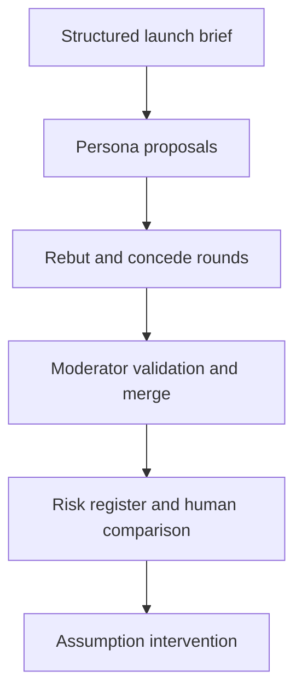

# Launch Premortem Risk Register (RiskCouncil)

[](https://github.com/MadanMohan0537/launch-premortem-risk-register/actions/workflows/ci.yml)

**Turn a product launch brief into a structured, multi-perspective premortem and a risk register, with every exported row tied to a concrete mechanism and assumption.**

*Previously named `riskcouncil`. The Python package and CLI are still called `riskcouncil`.*

---

## The problem

Premortems ("imagine the launch failed; why?") are a cheap way to surface risks before launch, but in practice they are skipped, constrained by who is in the room, or reduced to generic statements like "users may not adopt." Generic risks can't be owned or mitigated.

## Who it is for

Product managers, project/program managers, and launch teams who want a repeatable premortem format and a risk register they can hand to owners.

## Approach

- **Four stakeholder perspectives** (engineering, legal, finance, customer). Each persona record has a distinct goal, private context, and forbidden move. The generator branches on the persona name only, so private context and forbidden moves do not change the risks yet.
- **Fixed propose → rebut → concede rounds**, so runs are comparable and the debate can't sprawl.
- **Mechanisms are mandatory.** Validation reports mechanisms shorter than eight words, missing owners or mitigations, and likelihood or impact outside 1–5. It reports those errors; it does not drop the rows.
- **Assumptions are structured inputs**, so you can change one launch premise and see which mechanisms change (an *assumption intervention*).
- **Comparison with a human premortem** reports how many human-listed risks matched, recall and its denominator, and how many generated risks did not match. It does not list the unmatched titles.

The current personas are **deterministic rule-based simulations, not LLM agents**. That keeps tests free and repeatable. The tool does not claim that synthetic personas predict the future.

## What exists today

- Four personas, fixed debate rounds, moderator checks, and deterministic near-duplicate merging. Similar titles are merged only when they share an assumption; merged-away rows are dropped, with no provenance log.
- Risk records with likelihood, impact, score (likelihood × impact), owner, and mitigation. A `hypothesis` flag defaults to true and is not its own column. The markdown table shows score, title, mechanism, owner, and mitigation, and states that generated risks are hypotheses.
- Comparison with a human premortem list: matched count, recall and its denominator, and the count of generated risks absent from that list.
- Markdown and JSON exports. The JSON file includes the comparison counts and every intervention row. The printed summary omits the intervention block. Debate-note text is not written out; the JSON file includes the note count.
- A documented synthetic Atlas launch in `data/atlas_brief.json`. The demo inlines the same brief; the CLI does not read that file.
- Assumption-intervention experiment (below).
- Unit tests in CI on Python 3.11–3.13.

**Not in this repository:** an LLM generator, hosted collaboration, or ingestion of organizational postmortems. The [backlog](docs/BACKLOG.md) lists falsification cards, a persona-distinctness audit, an evidence-citation ledger, a facilitation budget, a historical-incident benchmark on public cases, ownership checks, dissent preservation, and mitigation selection. Blind human review is the next validation step named in the method notes, and it has not been run.

## Quick start

Requires Python 3.11 or newer (`requires-python` in `pyproject.toml`).

```bash
git clone https://github.com/MadanMohan0537/launch-premortem-risk-register.git
cd launch-premortem-risk-register
python -m venv .venv
source .venv/bin/activate
python -m pip install -e .
riskcouncil --markdown premortem.md --json premortem.json
```

Run tests:

```bash
python -m unittest discover -s tests -v
```

Running the tool needs no API key, model download, network call, paid service, or confidential data.

## Workflow



The intervention is a second debate on a copy of the brief with one assumption changed, then a row-by-row comparison with the baseline.

## Assumption-intervention experiment

The baseline in the demo assumes a 100-customer pilot with specialist review. The variant changes only the audience, to a global launch to all 10,000 customers. The acceptance rule encoded in the tests is:

- all four audience-linked mechanisms must change;
- all four support-model mechanisms must stay the same (controls);
- the JSON export includes the recall denominator (`human_risks`) and every intervention comparison row.

The Atlas demo passes this structural check: `targeted` is true, with four changed rows and four unchanged controls. That shows the intervention behaves as specified; it does not show causal validity. Blind human review is the next validation step, and it has not been run.

## Demo output

The baseline produces eight register rows that pass validation, and twenty-four debate notes. Against a three-item synthetic human list, the JSON export includes the matched count, recall, and the count of generated risks absent from that list. The markdown export includes recall and that count. These figures come from the authored fixture and are **not** evidence that the tool facilitates better than people do.

## How success should be measured (not yet measured)

- Share of risks in a real team's premortem that the register also captures, and useful risks it adds, judged blind.
- Share of register rows that get an owner and a mitigation within a week.
- After launch: how many incidents were anticipated by a register row.

## Design choices

- Fixed rounds make runs comparable and prevent unbounded chatter.
- Structured assumptions make intervention possible.
- Mandatory mechanisms, because generic risk labels are not actionable.
- Likelihood and impact stay ordinal judgments from 1 to 5, not probabilities. The markdown register shows their product as the score.
- A deterministic engine makes tests free and repeatable.

See [method and limitations](docs/METHOD.md) and [backlog](docs/BACKLOG.md).

## Repository structure

```text
riskcouncil/       personas, debate, moderation, comparison, reporting
tests/             deterministic workflow and intervention tests
data/              documented synthetic launch fixture (not loaded by the CLI)
docs/              method, limitations, and backlog
.github/           CI for Python 3.11–3.13
```

## License

MIT
