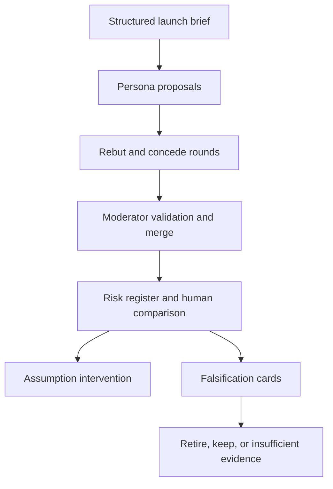

# RiskCouncil

[](https://github.com/MadanMohan0537/launch-premortem-risk-register/actions/workflows/ci.yml)

RiskCouncil turns a launch brief into a structured, multi-perspective premortem. Engineering, legal, finance, and customer personas propose risks, rebut one another, preserve concessions, and produce an auditable risk register with mechanisms, likelihood, impact, owners, and mitigations.

> **Project Lab traceability:** catalog Project 07, originally “Multi-Agent Premortem.” RiskCouncil is the product name; this metadata prevents the renamed idea from being built twice.

## What problem it solves

Premortems are often skipped, socially constrained, or reduced to generic statements such as “users may not adopt.” RiskCouncil requires every risk to name a mechanism and assumption, then measures overlap with a human list. It does not claim that synthetic personas predict the future.

## Implemented scope

- Four personas with distinct goals, private context, and forbidden moves.
- Fixed propose, rebut, and concede rounds for reproducible debates.
- Risk register with likelihood, impact, score, owner, mitigation, and hypothesis label.
- Validation that rejects vague mechanisms and incomplete register rows.
- Deterministic near-duplicate merging that preserves assumption provenance.
- Comparison with a human premortem: recall denominator and risks novel to the list.
- Markdown and JSON exports.
- Reproducible synthetic Atlas launch fixture.
- **P1 assumption intervention:** change one launch premise and verify linked risks change while unchanged assumptions act as controls.
- **P2 risk falsification cards:** attach a scoped disconfirming test, metric threshold, minimum sample, power note, and decision deadline to every risk; never treat weak evidence as safety.

Real LLM adapters, hosted collaboration, blind reviewer collection, historical-incident benchmarks, persona-distinctness audits, and organizational postmortem ingestion are planned—not implemented.

## Quick start

```bash
python -m venv .venv
source .venv/bin/activate
python -m pip install -e .
riskcouncil --markdown premortem.md --json premortem.json
```

Run tests:

```bash
python -m unittest discover -s tests -v
```

No API key, model download, network request, paid service, or confidential data is required.

## Workflow



## P1 experiment

The frozen baseline assumes a 100-customer pilot with specialist review. The variant changes only the audience to a global 10,000-customer launch. The acceptance rule is set in advance:

- all four audience-linked mechanisms must change;
- all four support-model mechanisms must remain unchanged;
- denominators and every comparison row must be exported.

The fixture passes this structural check. That establishes correct intervention behavior, not causal validity. Blind human review is the next required validation.

## P2 falsification experiment

Every frozen register row receives a falsification card. Engineering risks use
failure-injection load trials, legal risks use a claim-evidence census,
finance risks use sampled exception cost, and customer risks use task-based
sessions. Every card records its evidence scope and an explicit power
limitation.

The reproducible fixture evaluates eight cards:

| Outcome | Count |
|---|---:|
| Retirement candidates | 4 |
| Risks kept | 4 |
| Insufficient evidence | 0 |
| Review hours | 4.0 |
| Retirement candidates per review hour | 1.0 |

A passing threshold is not enough: a sample below the declared minimum or
evidence from another launch scope returns insufficient evidence. Retirement
remains a human decision; RiskCouncil only produces candidates.

## Demo output

The baseline generates eight validated register rows and twenty-four debate notes. Against a three-item synthetic human list, it reports the matched count, recall, and agent risks absent from that list. These numbers are demonstrations over authored fixtures, not evidence of superior facilitation.

## Design choices

- Fixed rounds make runs comparable and prevent unbounded agent chatter.
- Assumptions are structured inputs, making intervention possible.
- Mechanisms are mandatory because generic risk labels are not actionable.
- Likelihood and impact remain visible ordinal judgments, not false probabilities.
- The deterministic engine makes tests free and repeatable; model adapters can be evaluated later without changing the contract.
- Falsification thresholds and sample sizes are authored assumptions, not guarantees of statistical power.

See [the method and limitations](docs/METHOD.md) and [the rigorous backlog](docs/BACKLOG.md).

## Repository structure

```text
riskcouncil/       personas, debate, moderation, comparison, falsification, reporting
tests/             deterministic workflow and intervention tests
data/              documented synthetic launch fixture
docs/              method, limitations, and evidence-driven backlog
.github/           CI for Python 3.11–3.13
```

## License

MIT

